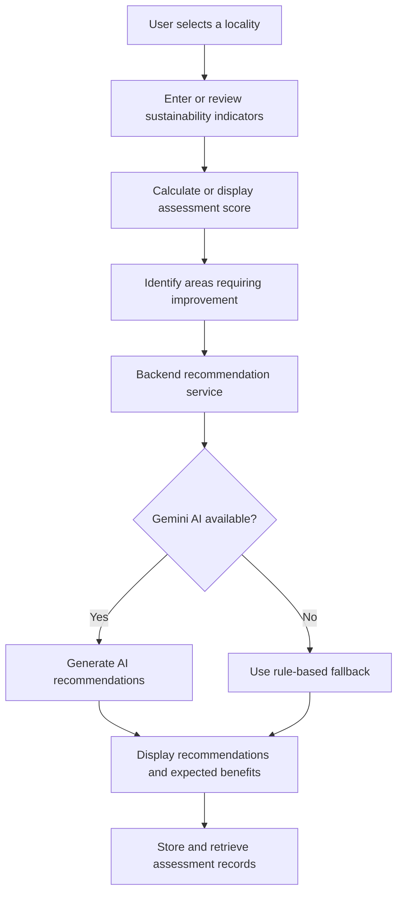

# 🌱 GreenCity AI — Generative AI-Based Sustainable City Planning

**An AI-powered sustainable city planning platform that evaluates urban sustainability indicators and provides actionable recommendations for greener, smarter, and more livable cities.**

[](https://react.dev/)
[](https://nodejs.org/)
[](https://expressjs.com/)
[](https://ai.google.dev/)
[](https://www.sqlite.org/)

## 📌 Project Overview

GreenCity AI is a Generative AI-based sustainable city planning project designed to help users assess urban sustainability and identify areas that may need improvement.

The application organizes sustainability assessments around key urban indicators, calculates or displays an overall sustainability score, and generates practical recommendations based on identified problem areas. When the Gemini AI service is unavailable or not configured, the backend can use rule-based recommendations as a fallback.

The goal is to support sustainability awareness and data-informed urban planning decisions through an accessible, interactive application.

## 🎯 Problem Statement

Cities face interconnected challenges involving waste management, water conservation, electricity consumption, traffic congestion, green spaces, public transportation, and electric-vehicle infrastructure.

Understanding these areas together can be difficult without a structured assessment and clear recommendations.

GreenCity AI brings these indicators into one platform to help users identify potential gaps and explore practical sustainability improvements for a selected locality.

## ✨ Key Features

- **Sustainability Assessment:** Evaluate sustainability indicators for a selected locality.
- **Overall Sustainability Score:** Present an overall score and sustainability status.
- **Indicator-Level Assessment:** Examine individual urban sustainability categories.
- **Generative AI Recommendations:** Generate contextual improvement suggestions using the Gemini API when configured.
- **Rule-Based Fallback:** Provide predefined recommendations when AI recommendations are unavailable.
- **Sustainability Assistant:** Support sustainability-related queries through the backend chat functionality.
- **Assessment Records:** Store and retrieve assessment information through the available backend data-storage implementation.
- **Database Viewer:** Browse stored assessments through the backend's database administration page.
- **Interactive Dashboard:** Present sustainability information through the React-based frontend.

## 🌍 Sustainability Indicators

GreenCity AI considers the following seven urban sustainability areas:

| Indicator | Focus Area |
|---|---|
| ♻️ Waste Management | Waste segregation, recycling, and waste reduction |
| 💧 Water Conservation | Water efficiency and rainwater harvesting |
| ⚡ Electricity Efficiency | Energy conservation and renewable-energy adoption |
| 🚗 Traffic Management | Sustainable mobility and traffic efficiency |
| 🌳 Green Spaces | Urban greenery and green-space development |
| 🚌 Public Transportation | Accessible and sustainable public transit |
| 🔋 EV Infrastructure | Electric-vehicle charging infrastructure |

## 🤖 How Generative AI Is Used

The Gemini integration is designed to generate recommendations using the locality, overall sustainability score, indicator scores, and identified problem areas.

The recommendation workflow is:

1. Receive the locality assessment and sustainability indicators.
2. Identify low-scoring indicators or areas that require attention.
3. Prepare the assessment context for the AI recommendation service.
4. Generate practical recommendations and expected benefits when the AI service is available.
5. Use rule-based recommendations if the AI service cannot provide a result.
6. Save the assessment and its related recommendation information through the available backend implementation.

The recommendations are intended to support exploration and planning. They should not be treated as official government assessments or verified real-time city data.

## 🔄 System Workflow



## 🏗️ System Architecture

GreenCity AI is organized into frontend and backend components.

### 1. Frontend

The frontend uses React and Vite to provide an interactive user interface. Tailwind CSS supports styling, while Recharts supports chart-based visualizations where used.

### 2. Backend

The primary Node.js and Express backend manages API requests, assessment recommendations, chat functionality, and stored assessment records.

### 3. Generative AI Service

The AI service integrates with Google's Gemini API to generate contextual sustainability recommendations. A rule-based fallback provides predefined suggestions if AI generation is unavailable.

### 4. Data Storage

The repository includes a JSON-based assessment-record implementation and a Python Flask implementation that uses SQLite. The exact storage path depends on which backend implementation is running.

## 🛠️ Technology Stack

| Category | Technologies |
|---|---|
| Frontend | React, React Router, Vite |
| Styling | Tailwind CSS |
| Data Visualization | Recharts |
| Backend | Node.js, Express.js |
| Generative AI | Google Gemini API |
| Data Storage | JSON files, SQLite |
| Python API Implementation | Python, Flask |
| Development Tools | Git, GitHub, npm |

## 📁 Project Structure

```text
GreenCity_AI_GENAI_CAPSTONE_PROJECT/
│
├── backend/
│   ├── routes/
│   │   ├── recommendationRoutes.js
│   │   └── chatRoutes.js
│   ├── services/
│   │   └── aiService.js
│   ├── server.js
│   ├── package.json
│   └── data/
│       └── assessments.json
│
├── frontend/
│   ├── src/
│   ├── public/
│   ├── package.json
│   └── ...
│
├── app.py
├── database.db
├── Green_City_AI_Capstone_Progress_Report.docx
├── Green_City_AI_Progress_Report.docx
├── package.json
└── README.md
```

*Note: This structure highlights the main files; additional files and folders are present in the repository.*

## 🚀 Getting Started

### Prerequisites

Install the following before running the application locally:

- Node.js and npm
- Git
- A Gemini API key if you want to use AI-generated recommendations

### 1. Clone the Repository

```bash
git clone https://github.com/pragathidevanga/GreenCity_AI_GENAI_CAPSTONE_PROJECT.git
cd GreenCity_AI_GENAI_CAPSTONE_PROJECT
```

### 2. Configure the Backend

Open a terminal in the project root and run:

```bash
cd backend
npm install
```

Create a `.env` file inside the `backend` directory:

```env
PORT=5000
GEMINI_API_KEY=your_gemini_api_key
```

Replace the placeholder with your own Gemini API key. Keep the key private and never commit your `.env` file to GitHub.

Start the backend:

```bash
npm run dev
```

The backend is configured to use port `5000` by default.

### 3. Start the Frontend

Open a second terminal from the project root:

```bash
cd frontend
npm install
npm run dev
```

Open the local URL printed by Vite in your terminal, typically:

`http://localhost:5173`

Ensure the frontend API configuration points to the backend running on your machine.

## 🔌 Backend API Endpoints

The Node.js backend exposes the following main endpoints:

| Method | Endpoint | Purpose |
|---|---|---|
| GET | `/` | Backend status and available routes |
| GET | `/api/health` | Check backend health |
| GET | `/admin/database` | View stored assessment records |
| GET | `/api/assessments` | Retrieve assessment records |
| POST | `/api/recommendations` | Generate recommendations and save an assessment |
| POST | `/api/chat` | Submit a sustainability-related query |

The backend runs locally on port `5000` by default. Endpoint availability depends on the backend being configured and running correctly.

## 🔐 Environment Variables and Security

- Store API credentials in environment variables.
- Never upload API keys, passwords, or private credentials to a public repository.
- Use `.env.example` to document required environment variables without exposing their values.
- Configure production environment variables through the deployment platform's settings.
- Validate incoming API data before using it in recommendations or storage operations.

## 🚧 Current Scope and Limitations

- Assessment quality depends on the accuracy and completeness of the supplied indicator information.
- AI-generated recommendations require valid Gemini API configuration and network access.
- Rule-based fallback recommendations may be shown if AI generation is unavailable.
- The sustainability score is an assessment aid, not a certified measure of a city's actual environmental performance.
- The repository contains more than one backend implementation; data and API behavior may differ depending on which implementation is used.

## 🔮 Future Enhancements

- Integrate verified public datasets for urban sustainability indicators.
- Add locality-wise data visualization and historical trend analysis.
- Improve assessment comparison between localities.
- Introduce user authentication and role-based access.
- Enhance validation, automated tests, and error handling.
- Expand sustainability metrics and provide more detailed reports.

## 🎓 Project Information

**Project Name:** GreenCity AI — Generative AI-Based Sustainable City Planning

**Project Type:** AI / Generative AI Capstone Project

**Repository:** [GreenCity AI on GitHub](https://github.com/pragathidevanga/GreenCity_AI_GENAI_CAPSTONE_PROJECT)

## 👩‍💻 Author

**Pragathi BR**
**Bhumika R**

- GitHub: [@pragathidevanga](https://github.com/pragathidevanga)
- LinkedIn: [Pragathi BR](https://www.linkedin.com/in/pragathi-br-4b1498405/)
- Portfolio: [pragathi-br.vercel.app](https://pragathi-br.vercel.app/)

## 🌱 Vision

GreenCity AI aims to make urban sustainability easier to understand by connecting sustainability indicators, assessment results, and actionable recommendations in one accessible platform.

*Building smarter cities through technology, sustainability, and responsible AI.*
